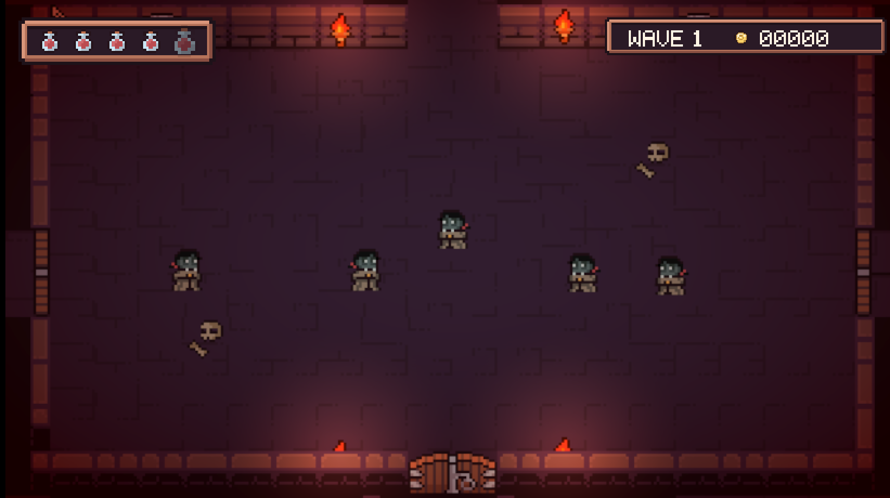

# Dungeon Slayer

A top-down survival shooter with roguelike elements, built solo in **Unity (C#)**.

**▶ Play it on itch.io: [auriwen.itch.io/dungeon-slayer](https://auriwen.itch.io/dungeon-slayer)**

## Features

- Top-down survival shooting
- Roguelike elements
- Highscore system

## Built with

- Unity, C#
- A third-party pixel-art dungeon asset pack for the graphics

## Running it locally

1. Install Unity Hub and Unity 6000.6.4f1 (see `ProjectSettings/ProjectVersion.txt`).
2. Open this folder as a project in Unity Hub.
3. Press Play.
